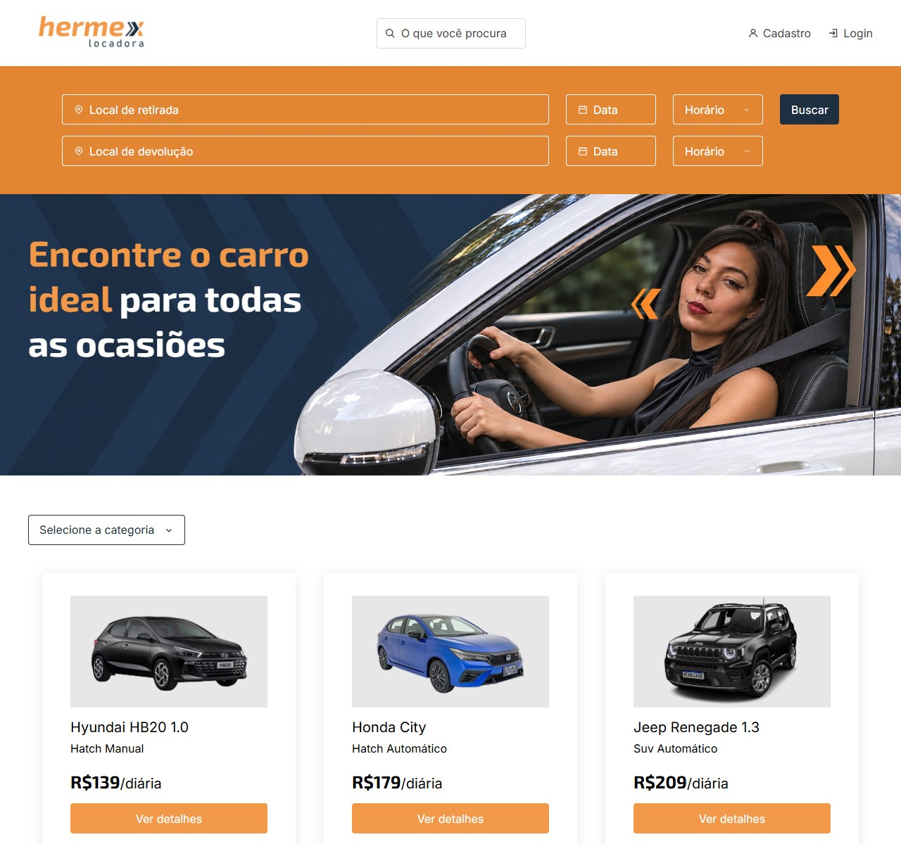

# Hermex — Locadora de veículos

Projeto desenvolvido por **Samuel** para fins educativos. O site simula uma locadora de veículos usando React, TypeScript, Vite, React Router e CSS Modules.

## Demonstração



1. Na [página inicial](http://localhost:5173/), filtre o catálogo por categoria ou preencha os dados de retirada e devolução para iniciar uma reserva.
2. Em **Ver detalhes**, confira as fotos, as características e a diária do carro. Um exemplo é o [Hyundai HB20](http://localhost:5173/veiculo/hb20).
3. Em **Reservar o veículo**, defina o local, as datas, os horários e a proteção opcional. O resumo mostra o valor total antes da confirmação.
4. Ao finalizar, a página de confirmação exibe o código da reserva e oferece opções para editar ou cancelar.

O cadastro, o login e as reservas são simulados no navegador. A sessão e as reservas são armazenadas no `localStorage`.

## Como executar

Use Node.js 24 com npm. Na raiz do projeto, instale as dependências e inicie o servidor de desenvolvimento.

```bash
npm ci
npm run dev
```

Abra o endereço exibido pelo Vite, normalmente [localhost:5173](http://localhost:5173/).

| Comando | Uso |
| --- | --- |
| `npm run lint` | Verificar o código com ESLint |
| `npm run build` | Verificar os tipos e gerar a versão de produção em `dist/` |
| `npm run preview` | Servir localmente a versão gerada pelo build |

## Estrutura

| Diretório | Conteúdo |
| --- | --- |
| `src/routes/` | Mapa de rotas |
| `src/layouts/` | Estrutura compartilhada das páginas, cabeçalho e rodapé |
| `src/pages/` | Página inicial, detalhes do veículo, reserva, confirmação e página de erro |
| `src/features/` | Autenticação, catálogo da frota e fluxo de reservas, com seus dados, componentes e regras |
| `src/components/` | Componentes compartilhados de interface, navegação e feedback |
| `src/styles/` | Tokens e estilos globais |
| `public/images/` | Imagens da marca, dos veículos e das redes sociais |

## Rotas principais

| Rota | Tela |
| --- | --- |
| `/` | Busca e catálogo |
| `/veiculo/:vehicleId` | Detalhes de um veículo |
| `/reservar?vehicle=:vehicleId` | Reserva do veículo selecionado |
| `/confirmacao?reservation=:reservationId` | Confirmação de uma reserva |
